# Apex Diagnostics & Patient Management System

<p align="center">
  
</p>

<p align="center">
  <strong>"Clinical-grade AI diagnostic laboratory, sample chain-of-custody, and patient management platform built on Laravel 13 &amp; Filament v3/v4."</strong>
</p>

<p align="center">
  <a href="https://laravel.com"></a>
  <a href="https://php.net"></a>
  <a href="https://filamentphp.com"></a>
  <a href="https://github.com/imranbru99/laravel-ai-hub"></a>
  <a href="https://github.com/imranbru99/diagnostics-patient-management/actions"></a>
  <a href="LICENSE"></a>
</p>

---

## 📌 Executive Overview

**Apex Diagnostics &amp; Patient Management** (`diagnostics-patient-management`) is an enterprise-grade clinical pathology, radiology, and laboratory automation system. Engineered for **Laravel 13**, **Laravel 12/11**, and **Filament v3/v4**, it unites barcode-tracked phlebotomy custody, automated biochemistry and hematology reference interval auditing, patient-facing plain-language AI report summarization, real-time biometric technician shift management, and cryptographic tamper-proof PDF delivery into a cohesive clinical ecosystem.

### Target Healthcare Facilities:
- **Clinical Pathology & Molecular Diagnostic Laboratories**
- **Hospital Diagnostic Wings & Satellite Sample Collection Hubs**
- **Radiology & Medical Imaging Centers** (Digital X-Ray, Ultrasonography, CT, MRI)
- **Multi-Branch Laboratory Networks** with Central Lab Accessioning & Courier Routing

---

## 🌟 Ecosystem Package Integration Map

This application is deeply wired into the open-source software ecosystem:

```mermaid
graph TD
    App[diagnostics-patient-management &bull; Laravel 13] --> AIHub[imrandevbd/laravel-ai-hub]
    App --> UniPdf[imrandevbd/laravel-unicode-pdf]
    App --> UniSlug[imrandevbd/laravel-universal-slug]
    App --> Attend[imrandevbd/laravel-attendance-hub]

    AIHub --> F1[AI Plain-Language Patient Summarizer]
    AIHub --> F2[Critical Value Flagging Before Sign-off]
    AIHub --> F3[Prescription & Requisition OCR Auto-Entry]
    AIHub --> F4[Patient-Facing Scoped RAG Chat Widget]
    AIHub --> F5[Doctor Differential Decision Co-Pilot]
    AIHub --> F6[AI Health Package Symptom Recommender]

    UniPdf --> P1[Bangla / English / Arabic Multilingual Reports]
    UniPdf --> P2[Scientific Units & Font Fallback: µ, °, ²]
    UniPdf --> P3[QR Code Authenticity Seal & SHA-256 Hash]
    UniPdf --> P4[Doctor Referral Commission Statements]

    UniSlug --> S1[SEO Test Catalog /tests/complete-blood-count]
    UniSlug --> S2[Unicode Patient URLs & Collision-Free Atomic Lock]

    Attend --> A1[ZKTeco & ADMS Biometric Terminal Sync]
    Attend --> A2[Phlebotomist & Technician Shift Roster]
```



### 1. `imrandevbd/laravel-ai-hub` — The Clinical AI Engine
Features autonomous multi-provider failover (`Gemini ➔ OpenAI ➔ Anthropic ➔ Groq ➔ Ollama`):
- **Plain-Language Patient Summarizer:** Converts clinical values (e.g., *Hemoglobin 11.2 g/dL*, *Platelets 140,000 /µL*) into reassuring, accessible patient-friendly summaries.
- **Automated Out-of-Range Flagging:** Scans results against age- and gender-specific biological intervals, marking `CRITICAL LOW` or `CRITICAL HIGH` alerts prior to pathologist sign-off.
- **Prescription & Requisition OCR:** Reads paper requisition slips and handwritten doctor notes, returning structured JSON to auto-populate patient intake.
- **Patient-Facing "Ask About Your Report" AI Chat:** A RAG-powered interactive assistant strictly scoped to the active patient's report with zero data leakage.
- **Doctor's AI Co-Pilot:** Provides differential consideration notes and potential confirmatory recommendations for reviewing physicians.
- **AI Health Package Recommender:** Patients type or select symptoms (*Fatigue*, *High Blood Sugar*, *Cardiac Discomfort*) to receive recommended diagnostic panels.
- **Studio Telemetry:** Real-time tracking of token usage, latency (ms), and cost per branch.

### 2. `imrandevbd/laravel-unicode-pdf` — Reports & Invoices
- Multilingual laboratory report rendering with RTL support (English, Bengali, Arabic).
- TrueType font fallback for scientific and medical symbols (`µg/dL`, `10^3/µL`, `°C`).
- Anti-forgery QR verification block containing a SHA-256 cryptographic hash of report parameters.
- Doctor referral commission statements and front-desk thermal invoices.

### 3. `imrandevbd/laravel-universal-slug` — SEO & Clean URLs
- Public SEO-friendly catalog URLs (`/tests/complete-blood-count`, `/tests/lipid-profile`).
- Locale-aware patient portal URLs (`/report/{slug}`) with atomic lock guarantees against intake collisions.

### 4. `imrandevbd/laravel-attendance-hub` — Staff & Biometric Shifts
- Direct ADMS / ZKTeco biometric device punch synchronization.
- Shift calculator (Morning, Evening, Night/STAT) for laboratory technologists and phlebotomists.
- Live bench presence tracking feeding into branch performance.

---

## 🎨 Modern UI & Design System

The application features an ultra-modern, clinical-grade interface:
- **Persistent Dark/Light Mode Engine:** Dynamic theme switcher in the navigation bar with instant `localStorage` persistence and zero-flicker startup.
- **Floating Glassmorphic Navbar:** Semi-transparent blurred header (`backdrop-blur-xl bg-white/85 dark:bg-darknavy-900/85`) with glowing brand logo, real-time STAT 24/7 hotline status, and responsive mobile navigation drawer.
- **Clinical Color Palette:** Medical Teal (`#14b8a6`), Clinical Emerald (`#10b981`), Deep Dark Navy (`#030712`), and subtle radial ambient glow effects.
- **Visual Range Indicator Gauges:** Every parameter in the report reader displays a horizontal color-coded indicator (`[Low | Normal | High | Critical]`) with observed needle markers.
- **Broadcast-Grade Lounge TV Screen:** 4K/1080p lobby queue board featuring a synthesized **Web Audio API Hospital Chime**, Now Serving booth cards, and announcement marquee.
- **Filament SPA Mode:** Instant single-page navigation enabled across all admin panels and widgets.

---

## 🏗️ 12 Core Clinical & Administrative Modules

### 1. Patient Master Index (MRN & Demographics)
- Automatic Medical Record Number generation (`MRN-YYYY-XXXXX`).
- Medical history, documented drug allergies, and emergency contact details.
- Linked family accounts (parents managing dependent children or spouses).
- Patient document vault for past external prescriptions and imaging scans.

### 2. Test Catalog & Reference Interval Engine
- Hierarchical category structure (Hematology, Biochemistry, Immunology, Radiology, Clinical Pathology, Molecular Genetics).
- Multi-tier biological reference intervals configurable by gender and age (pediatric, adult, geriatric).
- Turnaround time (TAT) targets, specimen preparation instructions, and collection tube color coding (*Lavender EDTA*, *Gold SST*, *Light Blue Citrate*, *Grey Fluoride*, *Red Plain*).

### 3. Barcode Sample Tracking & Custody Lifecycle
- Cryptographic barcode generation (`SMP-YYYY-XXXXXX`).
- 5-stage status pipeline:
  $$\text{Collected} \longrightarrow \text{In Transit} \longrightarrow \text{Received at Lab} \longrightarrow \text{In Testing} \longrightarrow \text{Verified}$$
- Full chain-of-custody audit log recording location, handler timestamp, and analyzer loading.
- Rejection and recollection workflow with standardized reason codes (`HEMOLYZED`, `CLOTTED`, `QNS`).

### 4. Interactive Report Builder & Clinical Review
- Grid-based parameter value entry with instant visual indicator updates (`normal`, `low`, `high`, `critical`).
- Single-click AI patient summary generation and doctor differential advisory.
- Pathologist digital sign-off and multi-channel publication (portal, SMS, WhatsApp, PDF).

### 5. Referring Doctor & Commission Payouts
- Directory of consulting physicians with department and hospital affiliations.
- Configurable referral commission rates (%) with automated order-level accruals.
- Referral commission statement generation via `laravel-unicode-pdf`.

### 6. Waiting Lounge & TV Queue Display
- Token generator distinguishing scheduled appointments (`A-101`) and walk-in arrivals (`W-005`).
- Fullscreen TV display mode (`/tv-queue`) with live clock and synthesized hospital chime triggers for waiting rooms.

### 7. Online Appointment Booking with AI Symptom Assistant
- 3-step interactive booking flow: Investigation Selection, Facility Scheduling, and Patient Demographics.
- Embedded AI Health Package Recommender matching symptoms to screening panels.
- Instant digital phlebotomy pass with scannable QR block, barcode reference, and preparation instructions.

### 8. Electronic Report Verification Portal
- SHA-256 cryptographic verification portal (`/verify-report/{hash}`).
- Certified electronic medical record seal, pathologist digital signature confirmation, and tamper-detection check.
- Interactive manual hash/barcode search bar.

### 9. Billing, Invoicing & Daily Cash Reconciliation
- Itemized billing with package discounts, partial payments, and balance tracking.
- Cash register drawer reconciliation at the close of daily front-desk shifts.
- Insurance claim provider and policy tracking.

### 10. Reagents & Consumables Inventory
- Stock quantity tracking, unit cost, lot numbers, and expiration dates.
- Automated low-stock alert thresholds.
- Reagent consumption tracking per investigation for accurate cost-per-test metrics.

### 11. Multi-Branch Operations (Satellite ➔ Central Lab)
- Central laboratory dashboard aggregating satellite collection points.
- Sample courier routing and accession tracking between branches.
- Branch-level financial, staff attendance, and inventory segmentation.

### 12. Filament v3/v4 Command Center & AI Studio
- Custom clinical palette and SPA mode navigation.
- Live sample pipeline Kanban board widget.
- Real-time AI Hub latency, cost, and failover status gauges.
- Staff biometric shift presence widget.
- Interactive AI prescription OCR auto-entry sandbox.

---

## ⚡ Quickstart & Docker Deployment

### Prerequisites
- **PHP 8.2, 8.3, or 8.4+**
- **Composer 2.x**
- **Node.js 20+**
- **Docker & Docker Compose** (Optional for containerized run)

### Method 1: Docker Compose (Recommended)

1. **Clone the repository:**
   ```bash
   git clone https://github.com/imranbru99/diagnostics-patient-management.git
   cd diagnostics-patient-management
   ```

2. **Environment configuration:**
   ```bash
   cp .env.example .env
   ```

3. **Launch Docker containers:**
   ```bash
   docker compose up -d --build
   ```

4. **Initialize database & seed clinical demo data:**
   ```bash
   docker compose exec app composer install
   docker compose exec app php artisan key:generate
   docker compose exec app php artisan migrate --seed
   ```

5. **Access Application:**
   - **Public Portal:** [http://localhost:8000](http://localhost:8000)
   - **Test Directory:** [http://localhost:8000/tests](http://localhost:8000/tests)
   - **Book Appointment:** [http://localhost:8000/book-appointment](http://localhost:8000/book-appointment)
   - **Lounge TV Queue Display:** [http://localhost:8000/tv-queue](http://localhost:8000/tv-queue)
   - **Report Verification:** [http://localhost:8000/verify-report/demo](http://localhost:8000/verify-report/demo)
   - **Patient Portal:** [http://localhost:8000/portal/login](http://localhost:8000/portal/login)
   - **Filament Admin Panel:** [http://localhost:8000/admin](http://localhost:8000/admin)

---

### Method 2: Local PHP Installation

```bash
composer install
cp .env.example .env
php artisan key:generate
touch database/database.sqlite
php artisan migrate --seed
php artisan serve
```

---

## 🔑 Default Seeded Demo Credentials

| Role | Email / Identifier | Password / PIN | Description |
|---|---|---|---|
| **System Admin** | `admin@apexdiagnostics.test` | `password` | Full system administrator with AI Studio |
| **Consultant Pathologist** | `nasreen@apexdiagnostics.test` | `password` | Clinical report sign-off & AI Co-Pilot |
| **Radiologist** | `tariq@apexdiagnostics.test` | `password` | Imaging reports & ultrasound findings |
| **Medical Technologist** | `kawsar@apexdiagnostics.test` | `password` | Phlebotomy custody & analyzer loading |
| **Front Desk Reception** | `reception@apexdiagnostics.test` | `password` | Billing, invoicing & token dispatch |
| **Demo Patient 1** | `MRN-2026-00001` or `+880 1712-345678` | `1234` | Patient portal with CBC report & AI chat |
| **Demo Patient 2** | `MRN-2026-00002` or `+880 1712-345679` | `1234` | Patient portal with Lipid Profile |

---

## 🌐 Application Route Index

| Route | Method | Controller Action | Description |
|---|---|---|---|
| `/` | `GET` | `PublicController@index` | Modern Homepage with test search & 4-stage pipeline |
| `/tests` | `GET` | `PublicController@testCatalog` | Searchable Test Catalog with department filters |
| `/tests/{slug}` | `GET` | `PublicController@testDetail` | Investigation Details, parameters & tube spec |
| `/book-appointment` | `GET/POST` | `PublicController@bookAppointmentForm` | 3-step booking with AI package recommender |
| `/book-appointment/confirmed/{number}` | `GET` | `PublicController@bookingConfirmation` | Electronic phlebotomy pass & token QR slip |
| `/tv-queue` | `GET` | `PublicController@tvQueue` | Broadcast TV display screen with audio chime |
| `/verify-report/{hash}` | `GET` | `PublicController@verifyReport` | SHA-256 cryptographic verification portal |
| `/api/recommend-packages` | `POST` | `PublicController@recommendPackagesApi` | AI symptom-based package recommendation API |
| `/portal/login` | `GET/POST` | `PatientPortalController@login` | Patient portal authentication (MRN / OTP) |
| `/portal/dashboard` | `GET` | `PatientPortalController@dashboard` | Patient command center & report history |
| `/portal/chat` | `POST` | `PatientPortalController@chatAboutReport` | Scoped RAG AI assistant for patient report |
| `/report/{slug}` | `GET` | `PatientPortalController@viewReport` | Interactive clinical report viewer with AI |
| `/report/{slug}/pdf` | `GET` | `PatientPortalController@downloadPdf` | Official encrypted PDF report download |
| `/admin` | `GET` | Filament Panel | Lab Staff, Pathologists & AI Studio Panel |

---

## 🧪 Automated Test Suite

Run the comprehensive test suite with:

```bash
php artisan test
```

The test suite validates:
- MRN and universal slug generation with atomic lock.
- Barcode chain-of-custody state machine transitions.
- Biological reference interval abnormal and critical flagging.
- Plain-language AI summarization and symptom-based package recommendations.
- SHA-256 cryptographic report authenticity checks.
- Scoped RAG assistant bounds against data leakage.

---

## 📄 License

The core of **Apex Diagnostics &amp; Patient Management** is open-source software licensed under the **[MIT License](LICENSE)**.

---

## 📬 Contact & About

Apex Diagnostics is an AI-powered clinical laboratory & patient management platform built with Laravel 11/12 & Filament v3. Features barcode phlebotomy chain-of-custody, plain-language AI report summarization, automated critical interval alerts, interactive patient portal with scoped RAG chat, live lounge TV queue calling, biometric shift attendance sync, and multilingual PDF delivery.

<p align="center">
  Crafted with care by <a href="https://github.com/imranbru99"><strong>Imran Dev BD</strong></a>
</p>

