# Apex Diagnostics & Patient Management System

<p align="center">
  
</p>

<p align="center">
  <strong>"AI-powered patient, sample &amp; report management for modern diagnostic centers."</strong>
</p>

<p align="center">
  <a href="https://github.com/imranbru99/diagnostics-patient-management/actions"></a>
  <a href="https://php.net"></a>
  <a href="https://laravel.com"></a>
  <a href="https://filamentphp.com"></a>
  <a href="https://github.com/imranbru99/laravel-ai-hub"></a>
  <a href="LICENSE"></a>
</p>

---

## 📌 Executive Overview

**Apex Diagnostics &amp; Patient Management** (`diagnostics-patient-management`) is a clinical-grade, enterprise diagnostic center and laboratory automation application. Built on top of **Laravel 11/12** and **Filament v3/v4**, it unites barcode-tracked phlebotomy custody, automated biochemistry/hematology reference interval flagging, patient-facing plain-language AI report summarization, biometric technician attendance, and multilingual PDF delivery into a single cohesive clinical workflow.

### Target Organizations:
- Clinical Pathology & Molecular Diagnostic Laboratories
- Hospital Diagnostic Wings & Satellite Specimen Collection Kiosks
- Radiology & Medical Imaging Centers (X-Ray, Ultrasonography, CT, MRI)
- Multi-Branch Laboratory Franchises with Central Lab Routing

---

## 🌟 Ecosystem Package Integration Map

This application is deeply wired into the `imrandevbd` open-source software ecosystem:

```mermaid
graph TD
    App[diagnostics-patient-management] --> AIHub[imrandevbd/laravel-ai-hub]
    App --> UniPdf[imrandevbd/laravel-unicode-pdf]
    App --> UniSlug[imrandevbd/laravel-universal-slug]
    App --> Attend[imrandevbd/laravel-attendance-hub]
    App --> RBAC[imrandevbd/adhikar / Spatie]

    AIHub --> F1[AI Plain-Language Report Summarizer]
    AIHub --> F2[Critical Value Flagging Before Sign-off]
    AIHub --> F3[Requisition & Prescription OCR Auto-Entry]
    AIHub --> F4[Patient-Facing Scoped RAG Chat Widget]
    AIHub --> F5[Doctor Decision Support Co-Pilot]

    UniPdf --> P1[Bangla / English / Arabic Multilingual Reports]
    UniPdf --> P2[Scientific Units & Font Fallback: µ, °, ²]
    UniPdf --> P3[QR Code Authenticity Seal]
    UniPdf --> P4[Doctor Referral Commission Statements]

    UniSlug --> S1[SEO Test Catalog /tests/complete-blood-count]
    UniSlug --> S2[Unicode Patient URLs & Atomic Lock]

    Attend --> A1[ZKTeco & ADMS Biometric Terminal Sync]
    Attend --> A2[Phlebotomist & Technician Shift Roster]
```



### 1. `imrandevbd/laravel-ai-hub` — The AI Engine
Features autonomous multi-provider failover (`Gemini ➔ OpenAI ➔ Anthropic ➔ Groq ➔ Ollama`):
- **Plain-Language Patient Summarizer:** Converts clinical values (e.g., Hemoglobin 11.2 g/dL, Platelets 140,000) into reassuring, accessible patient-friendly summaries.
- **Automated Out-of-Range Flagging:** Automatically scans results against age- and gender-specific biological intervals and marks `CRITICAL LOW` or `CRITICAL HIGH` alerts before pathologist sign-off.
- **Prescription & Requisition OCR:** Reads paper requisition slips and handwritten doctor notes, returning clean JSON to auto-populate patient intake.
- **Patient-Facing "Ask About Your Report" AI Chat:** A RAG-powered interactive assistant strictly scoped to the active patient's report with zero data leakage.
- **Doctor's AI Co-Pilot:** Provides differential consideration notes and potential confirmatory recommendations for reviewing physicians (advisory only).
- **Studio Telemetry:** Real-time tracking of token usage, latency (ms), and cost per branch.

### 2. `imrandevbd/laravel-unicode-pdf` — Reports & Invoices
- Multilingual laboratory report rendering with RTL support (English, Bengali, Arabic).
- TrueType font fallback for scientific and medical symbols (`µg/dL`, `10^3/µL`, `°C`).
- Anti-forgery QR verification block containing a SHA-256 cryptographic hash of report parameters.
- Doctor referral commission statements and front-desk thermal invoices.

### 3. `imrandevbd/laravel-universal-slug` — SEO & Clean URLs
- Public SEO-friendly catalog URLs (`/tests/complete-blood-count`, `/tests/lipid-profile`).
- Locale-aware patient portal URLs (`/report/{slug}`) with atomic lock guarantees against intake collisions.

### 4. `imrandevbd/laravel-attendance-hub` — Staff & Biometric Shifts
- Direct ADMS / ZKTeco biometric device punch synchronization.
- Shift calculator (Morning, Evening, Night/STAT) for laboratory technologists and phlebotomists.
- Feeds into branch performance and staff cost accounting.

---

## 🏗️ 11 Core Functional Modules

### 1. Patient Master Index (MRN & Demographics)
- Automatic Medical Record Number generation (`MRN-YYYY-XXXXX`).
- Medical history, documented drug allergies, and emergency contact details.
- Linked family accounts (parents managing dependent children or spouses).
- Patient document vault for past external prescriptions and imaging scans.

### 2. Test Catalog & Reference Interval Engine
- Hierarchical category structure (Hematology, Biochemistry, Immunology, Radiology, Clinical Pathology).
- Multi-tier biological reference intervals configurable by gender and age (pediatric, adult, geriatric).
- Turnaround time (TAT) targets, specimen preparation instructions, and collection tube color coding.

### 3. Barcode Sample Tracking & Custody Lifecycle
- Cryptographic barcode generation (`SMP-YYYY-XXXXXX`).
- 5-stage status pipeline:
  $$\text{Collected} \longrightarrow \text{In Transit} \longrightarrow \text{Received at Lab} \longrightarrow \text{In Testing} \longrightarrow \text{Verified}$$
- Full chain-of-custody audit log recording location, handler timestamp, and analyzer loading.
- Rejection and recollection workflow with standardized reason codes (`HEMOLYZED`, `CLOTTED`, `QNS`).

### 4. Interactive Report Builder & Clinical Review
- Grid-based parameter value entry with instant visual indicator updates (`normal`, `low`, `high`, `critical`).
- Single-click AI patient summary generation and doctor differential advisory.
- Pathologist digital sign-off and multi-channel publication (portal, SMS, WhatsApp, PDF).

### 5. Referring Doctor & Commission Payouts
- Directory of consulting physicians with department and hospital affiliations.
- Configurable referral commission rates (%) with automated order-level accruals.
- Referral commission statement generation via `laravel-unicode-pdf`.

### 6. Waiting Lounge & TV Queue Display
- Token generator distinguishing scheduled appointments (`A-101`) and walk-in arrivals (`W-005`).
- Fullscreen TV display mode (`/tv-queue`) with live clock and audio chime triggers for waiting rooms.

### 7. Billing, Invoicing & Daily Cash Reconciliation
- Itemized billing with package discounts, partial payments, and balance tracking.
- Cash register drawer reconciliation at the close of daily front-desk shifts.
- Insurance claim provider and policy tracking.

### 8. Reagents & Consumables Inventory
- Stock quantity tracking, unit cost, lot numbers, and expiration dates.
- Automated low-stock alert thresholds.
- Reagent consumption tracking per investigation for accurate cost-per-test metrics.

### 9. Multi-Branch Operations (Satellite ➔ Central Lab)
- Central laboratory dashboard aggregating satellite collection points.
- Sample courier routing and accession tracking between branches.
- Branch-level financial, staff attendance, and inventory segmentation.

### 10. Filament v3/v4 Command Center
- Clinical Teal and Emerald custom palette.
- Live sample pipeline Kanban board widget.
- Real-time AI Hub latency, cost, and failover status gauges.
- Staff biometric shift presence widget.

### 11. Responsive Patient Web Portal
- Secure OTP or MRN sign-in.
- Interactive report visualizer with normal-range indicator bars.
- Integrated **"Ask About Your Report"** AI assistant.
- Authentic QR-code verification portal (`/verify-report/{hash}`).

---

## ⚡ Quickstart & Docker Deployment

### Method 1: Docker Compose (Recommended)

1. **Clone the repository:**
   ```bash
   git clone https://github.com/imranbru99/diagnostics-patient-management.git
   cd diagnostics-patient-management
   ```

2. **Environment configuration:**
   ```bash
   cp .env.example .env
   ```

3. **Launch Docker containers:**
   ```bash
   docker compose up -d --build
   ```

4. **Initialize database & seed clinical demo data:**
   ```bash
   docker compose exec app composer install
   docker compose exec app php artisan key:generate
   docker compose exec app php artisan migrate --seed
   ```

5. **Access Application:**
   - **Public Portal:** [http://localhost:8000](http://localhost:8000)
   - **Test Catalog:** [http://localhost:8000/tests](http://localhost:8000/tests)
   - **Lounge TV Queue Display:** [http://localhost:8000/tv-queue](http://localhost:8000/tv-queue)
   - **Patient Portal:** [http://localhost:8000/portal/login](http://localhost:8000/portal/login)
   - **Filament Admin Panel:** [http://localhost:8000/admin](http://localhost:8000/admin)

---

## 🔑 Default Seeded Demo Credentials

| Role | Email / Identifier | Password / PIN | Description |
|---|---|---|---|
| **Admin** | `admin@apexdiagnostics.test` | `password` | Full system administrator |
| **Pathologist** | `nasreen@apexdiagnostics.test` | `password` | Clinical report sign-off & review |
| **Radiologist** | `tariq@apexdiagnostics.test` | `password` | Imaging reports & findings |
| **Technologist** | `kawsar@apexdiagnostics.test` | `password` | Sample collection & analyzers |
| **Receptionist** | `reception@apexdiagnostics.test` | `password` | Front desk billing & queue |
| **Patient Demo** | `MRN-2026-00001` or `+880 1712-345678` | `1234` | Patient portal with CBC report |

---

## 🧪 Automated Test Suite

Run the comprehensive test suite with:

```bash
php artisan test
```

The test suite validates:
- MRN and universal slug generation.
- Barcode chain-of-custody state machine transitions.
- Biological reference interval abnormal and critical flagging.
- Plain-language AI summarization pipeline.
- SHA-256 cryptographic report authenticity checks.

---

## 📄 License

The core of **Apex Diagnostics &amp; Patient Management** is open-sourced software licensed under the **[MIT License](LICENSE)**.

---

<p align="center">
  Crafted with care by <a href="https://github.com/imranbru99"><strong>Imran Dev BD</strong></a>
</p>
